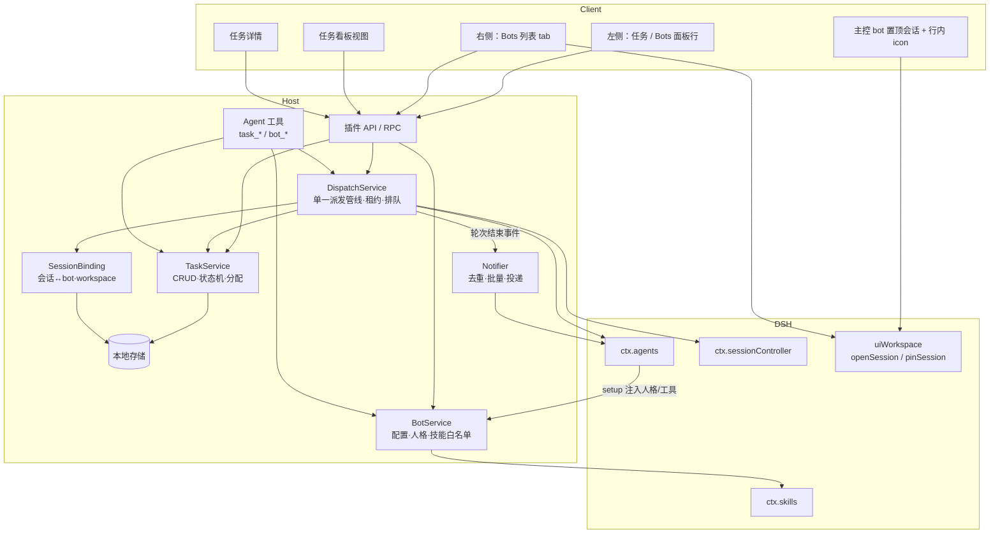

# DSH Bots & Taskboard 需求文档

> 状态：草案 v0.2（仅需求记录，尚未实现）
> 日期：2026-11-21
> 参考实现：[ttmouse/dsh-taskboard](https://github.com/ttmouse/dsh-taskboard#readme)
> 交付形态：DeepSeek Harness（DSH）插件 bundle，Host + Client 双侧

**变更记录**

- v0.1：初稿，左侧 Bots 列表方案待定。
- v0.2：确定 **方案 D**——Bots 列表放右侧栏；左侧保留主控 bot 常驻展示；bot 支持自定义 icon；会话列表按 bot 关联展示 icon；明确私聊会话归默认 workspace、任务会话归任务所属 workspace。
- v0.3：按推荐行为定稿（线性图标、置顶可取消、任务 workspace 取创建时活动 workspace）；**技能分两层**——bot 配置的是用户级 skills 白名单，项目 workspace 自带的 skills 额外自动加载；新增《模型假设分析》见 `docs/model-assumptions.md`。

---

## 1. 背景与目标

DSH 目前只有「会话」这一种一等公民：每个会话对应一个 agent，人要和 agent 协作，只能在会话里说话。缺少两样东西：

1. **可持续的任务管理**：事情一旦跨天、跨会话，就散落在聊天记录里，人看不到全局，agent 也不知道「还有哪些没做完」。
2. **可复用的 agent 身份**：每次都从零写 system prompt、每次都要重新交代技能和职责，无法沉淀出「我的助理」「我的前端工程师」这类稳定角色。

本项目要补上这两块，并让它们互相咬合：

- **Bots**：可创建、可配置的 agent 身份（名称、icon、额外 system prompt、启用哪些 skills、是否主控），每个 bot 有固定的私聊会话。
- **Taskboard**：人和 agent 共用的任务看板，任务可分配给人、分配给 bot、或留空由主控 bot 分派。
- **联动**：主控 bot 记录任务 → 分派给执行 bot → 执行 bot 在任务会话里干活 → 完成后通知主控 bot → 主控 bot 汇总汇报给人。

一句话：**人只跟主控 bot 对话，主控 bot 用任务板调度其余 bot。**

### 1.1 设计原则

- **本地优先**：数据只存本机（DSH profile 目录），不引入外部服务、账号、网络依赖。
- **会话是执行载体**：不发明第二套 agent 运行时；任务执行 = 一个真实 DSH 会话。
- **人和 agent 同一张板**：人是任务板的一等参与者，不是「管理员视角」。
- **单一派发管线**：所有触发执行的入口（人点「派发」、主控 bot 调工具、自动规则、评论触发）都收敛到同一条管线，避免多路径状态不一致（沿用参考项目 ADR-0001）。
- **不伪造运行时**：任务/通知等插件自有数据不写成 DSH session 事件，避免会话无法重开。
- **尽量复用 DSH 原生能力**：会话打开/置顶/归属 workspace 都走 `uiWorkspace` 与 `sessionController` 的既有能力，不另起一套导航。

### 1.2 非目标（本期不做）

- 多人协作 / 权限模型 / 远端同步。
- 跨机器、跨 profile 的任务共享。
- 通用工作流引擎（参考项目有 workflow 视图，本期只做看板 + 列表）。
- 移动端 / 独立 Web 应用。
- 替 DSH 本身实现「多 agent 群聊」。

---

## 2. 核心概念

| 概念 | 定义 |
| --- | --- |
| **Bot（机器人）** | 一个可复用的 agent 身份。含名称、icon、额外 system prompt、启用的 skills 白名单、是否主控。 |
| **私聊会话（Private Session）** | 每个 bot 固定绑定的一个 DSH 会话，等同于和这个角色持续对话；归属**默认 workspace**。 |
| **任务（Task）** | 一件可追踪的工作项。有状态、负责人、优先级、描述、评论、所属 workspace、可选的任务会话。 |
| **任务会话（Task Session）** | 某个任务专属的执行会话，由派发时创建，标题带任务号，**归属任务所属 workspace**。 |
| **分派（Assignment）** | 把任务交给某个 bot 或某个人。 |
| **派发（Dispatch）** | 让某个 bot 真正开始执行任务：确保有任务会话、向其投递执行指令、登记租约。 |
| **主控 Bot（Orchestrator）** | 被标记为「主控」的 bot。接收任务板工具，负责把未分配任务分派给合适的 bot，并汇总结果。 |
| **轮次（Round）** | 一次派发产生的执行过程，从派发到租约释放。 |
| **通知（Notification）** | 任务状态变化（完成/失败/待审）推送给主控 bot 的结构化消息。 |
| **人（Human）** | 本机用户。可作为任务负责人，但没有独立账号体系。 |

---

## 3. 功能需求

### 3.1 Bots 管理

#### 3.1.1 创建 / 编辑 Bot

字段：

| 字段 | 必填 | 说明 |
| --- | --- | --- |
| `name` | 是 | 显示名，唯一性仅做软校验（重名提示） |
| `icon` | 否 | **内置图标集中的 iconId**（插件自带一套**线性风格** SVG 图标，24–32 个，贴合 DSH 视觉）；未选时回退为名称首字色块 |
| `systemPrompt` | 否 | **追加**在 DSH 基础系统提示之后的角色设定；不替换基础提示 |
| `skills` | 否 | **用户级 skills 白名单**：该 bot 额外启用的用户级 skill id 列表；空 = 不启用任何用户级 skill。项目 workspace 自带的 skills 不受此限制，自动可用（见 3.1.2） |
| `isOrchestrator` | 否 | 主控标记；全局至多一个（见 3.1.3） |
| `workspace` | 否 | 该 bot 默认工作目录，影响其会话 cwd 与可用 skill 目录；默认继承「Bots 默认 workspace」设置 |
| `model` | 否 | 可选模型覆盖，留空用 DSH 默认 |
| `archived` | 否 | 归档后不出现在列表，其历史会话保留 |

**icon 实现约定**：图标由插件自带（SVG + iconId → 组件映射），存 iconId 而非 emoji 字符串。理由：不依赖 DSH 内部图标注册表的非公开接口，升级不会碎；同时保证侧栏、看板卡片、会话行、右侧列表四处渲染一致。统一线性风格（1.5px 描边、圆角端点），选择器以网格弹层呈现，支持搜索。

行为：

- 创建后**自动创建私聊会话**（或首次点击时懒创建），并把 `sessionId` 写回 bot 记录；私聊会话归属默认 workspace，并自动**置顶**（`uiWorkspace.pinSession`），使其常驻会话列表顶部。
- 编辑 `systemPrompt` / `skills` **只影响之后的会话轮次**，不回溯改写已有聊天记录。
- 删除 = 归档（保留会话与任务引用），避免任务指向悬空 bot。

#### 3.1.2 Bot 人格与技能注入

- 人格：在 agent 创建时（`ctx.agents.create/resume` 的 `setup` 钩子）向该 agent 的系统提示追加 bot 的 `systemPrompt`，并附加一段由插件生成的「角色卡」：bot 名、职责、可用 skills 清单、是否主控、任务板工具使用约定。
- 技能白名单（**两层模型**）：
  - **用户级 skills**：由 bot 配置勾选，是「这个角色额外具备的能力」；未勾选即不加载，避免所有 bot 都背一份巨大技能目录。
  - **项目级 skills**：会话所在 workspace 自带的 skills **自动加载**，不需要也不允许通过 bot 配置关闭——角色可以选能力，但不能剥夺项目约定。
  - **有效集合 = 用户级白名单 ∪ 当前 workspace 的项目 skills**（注意：同一 bot 在私聊与任务会话里 cwd 可能不同，项目级部分因此可能不同，属预期）。
  - 系统提示分两段枚举：`你额外启用的技能` 与 `本项目自带技能`，让模型明白两者来源不同。
  - 对 `skill` 工具加 per-agent guard：请求的 skill 不在有效集合内则拒绝并返回两份清单。
  - 不改变全局 skill 注册表，不影响其他 bot 和普通会话。
- 约束：bot 的注入必须绑定在 **agent scope**，不能写全局系统提示，否则会污染所有会话。

#### 3.1.3 主控 Bot

- 全局至多一个 `isOrchestrator=true` 的 bot；设置新的时提示是否转移。
- 主控 bot 额外获得任务板工具（见 3.4）与任务通知（见 3.5）。
- 主控 bot 不做特殊 UI，仍是普通 bot 私聊；「主控」只是权限与职责标记。

### 3.2 侧栏布局（v0.2 定稿：方案 D）

#### 3.2.1 左侧边栏

左侧保留两个入口 + 一个常驻展示：

| 元素 | 形态 | 位置/槽位 |
| --- | --- | --- |
| **任务** | 面板行（看板图标） | `sidebar.panellist`，切到任务看板主面板 |
| **Bots** | 面板行（bots 图标） | `sidebar.panellist`，切到 Bots 管理主面板（新建/编辑/归档/设主控） |
| **主控 bot 常驻展示** | 主控 bot 的私聊会话置顶在默认 workspace 会话列表顶部，行上带 bot icon 与「主控」徽标 | 会话列表（`ui-workspace`）+ 行内 `sidebar.session.row.trailing` 插槽 |
| **主控 bot 快捷入口（可选）** | 侧栏底部一个主控 bot 头像按钮，未读时带小红点，点击直接进私聊 | `sidebar.footer.action`（list） |

- 「主控 bot 常驻展示」不新增侧栏分区——`sidebar.workspaces` 是 `single` 槽位且已被 `ui-workspace` 独占，硬塞第二段会破坏搜索/分组/拖拽，因此用「置顶会话 + 行内 icon/徽标」实现，视觉上仍在左侧栏内且始终可见。
- **定稿**：置顶由插件在创建/修复绑定时调用 `uiWorkspace.pinSession(sessionId)` 完成；用户可手动取消置顶，插件不强制恢复，只在 bot 重新绑定会话时再置顶一次。主控私聊不再有「不可取消」的特权——常驻性靠「置顶 + 底部快捷入口」双保险，而不是靠锁死。

#### 3.2.2 右侧栏：Bots 列表栏目

- 通过 `sidebarRightTabs.register({ id: 'bots', kind: 'bots', title: 'Bots' })` + `sidebar.right.pane.tab` 注册一个右侧栏 tab，`keepMounted` 保持状态。
- 列表项：bot icon、名称、一句话职责（systemPrompt 首行摘要）、状态点（空闲 / 执行中 / 未读）、当前任务数。
- 点击列表项 = **直接打开该 bot 的私聊会话**（`uiWorkspace.openSession(sessionId)`），不做二次确认。
- 每项右侧有「⋯」：编辑、查看任务、归档。
- 顶部有「+ 新建 bot」，新建成功后自动打开私聊。
- 入口：左侧「Bots」面板行旁可加一个「在右侧栏打开列表」按钮；同时注册命令/快捷键。

#### 3.2.3 会话列表中的 bot 标识

- 会话若关联了 bot（私聊会话或任务会话），在会话行渲染该 bot 的 icon。
- 实现：`sidebar.session.row.trailing` 注册一个小组件，只拿到 `sessionId`；通过插件的 client store 查询 `sessionId → bot` 映射（Host 侧持久化，客户端订阅）。
- 私聊会话额外展示「主控」徽标；任务会话展示任务号（如 `T-1024`）而非 bot 名，避免行过长。
- 图标尺寸 12–14px，行内 hover 时随 trailing 一起被操作按钮替换，属预期行为。

#### 3.2.4 实现差异（v19 落地后回填）

| 需求 | 实际实现 | 差异原因 |
| --- | --- | --- |
| 左侧「任务」「Bots」两个面板行 | `sidebar.panellist` 注册 `dsh-bots`（order 51，「任务板」）与 `dsh-bots-bots`（order 52，「Bots」），各自有 `main` keyed slot | 一致；「Bots」行是 v19 加的快速入口，一步直达列表 |
| 主控私聊置顶 | **未做** `pinSession`；改为会话行 trailing 徽标 + 两个入口直达 | 置顶是用户可手动取消的弱约束，收益低于「永远有一处一键可达」，先不做 |
| `sidebar.footer.action` 底部头像 | **未做** | 现版本该位置是 Settings 的固定座位，扩展点不稳定；用左侧「Bots」行替代 |
| 右侧栏 tab id `bots` / kind `bots` | `id: "@dsh-external/dsh-bots/bots"`、`kind: "dsh-bots"` | 右侧栏要求 `id` 全局唯一且同时作为 body 槽的 key，用包名限定避免撞车 |
| 列表项状态点 / 任务数 / 「⋯」菜单 | 行为 button（整行点开私聊）、图标块、主控胶囊、状态点、在办数；无「⋯」菜单 | 编辑/删除放在主面板卡片上，右侧栏保持「快速切换」单一职责 |
| 顶部「+ 新建 bot」 | 未做（右侧栏只有刷新） | 新建需要表单，放右侧窄栏体验差；主面板与左侧 Bots 行都有 |

### 3.3 任务管理

#### 3.3.1 任务字段

| 字段 | 说明 |
| --- | --- |
| `id` | 短 id（如 `T-1024`），便于在对话中引用 |
| `title` | 标题 |
| `description` | Markdown 正文 |
| `status` | `backlog` / `todo` / `in_progress` / `in_review` / `done` / `canceled` / `blocked` |
| `assignee` | `{ kind: 'bot', botId }` / `{ kind: 'human' }` / `null`（未分配） |
| `agentRequired` | 是否要求由 agent 执行；未分配 + `true` 时进入主控分派队列 |
| `priority` | `low` / `normal` / `high` / `urgent` |
| `labels` | 字符串标签 |
| `workspaceId` | 任务所属 workspace；决定任务会话归属（默认取创建时的活动 workspace） |
| `parentId` / `blocks` / `blockedBy` | 层级与依赖（依赖未完成时不可派发） |
| `sessionId` | 当前/最近的任务会话 |
| `dispatchedAt` / `leaseUntil` | 派发与租约状态 |
| `createdBy` | `human` 或某个 bot |
| `createdAt` / `updatedAt` / `completedAt` | 时间戳 |

#### 3.3.2 分配语义（关键）

1. **分配给人**：任务出现在「我的任务」，不触发任何 agent 执行。
2. **分配给 bot**：可显式派发（人点「派发」或主控 bot 调工具），执行该 bot 的任务会话。
3. **未分配 + `agentRequired=false`**：纯待办，等人认领或后续处理，不打扰任何 bot。
4. **未分配 + `agentRequired=true`**：进入**主控分派队列**；主控 bot 收到通知后决定分给哪个 bot（或自己），并调用派发工具。
   - 主控不可用（未配置/会话异常）时：任务停留在队列并在 UI 上标记「等待分派」，人可手动指派。

> 待确认：主控是「自动轮询分派」还是「收到通知后由模型决定」。推荐后者（LLM 判断更合理），并加兜底超时提醒（见 §8-Q2）。

#### 3.3.3 状态机

```
backlog ──立项──> todo ──派发──> in_progress ──提交──> in_review ──验收──> done
   │               │  ↑                                  │
   │               │  └──────────打回────────────────────┘
   │               └──取消──> canceled
   └──取消──> canceled
任意状态 ──阻塞──> blocked ──解除──> 原状态
```

- `in_review` 表示「agent 做完了，等人或主控验收」；验收通过才 `done`。
- 状态变更需记录活动日志（谁、何时、从什么到什么）。

#### 3.3.4 看板视图

5 列（与参考实现一致，状态 ≠ 列）：

| 列 | 包含状态 | 说明 |
| --- | --- | --- |
| **等你** | `in_review` + `blocked` | 永远存在、排第一；需要人/主控决策 |
| **处理中** | `in_progress` | 有活跃租约的任务 |
| **等待认领** | `todo` | 可被派发的任务池 |
| **已完成** | `done` + `canceled` | 默认折叠，显示计数 |
| **待立项** | `backlog` | 默认折叠，不进入执行流程 |

- 卡片显示：任务号、标题、负责人（bot icon / 人 / 未分配）、优先级、标签、所属 workspace、最近活动时间、是否有进行中轮次。
- 拖拽改列 = 改状态；拖到「等待认领」不清空负责人，需显式取消分配。
- 列表视图与看板共用同一数据源；筛选条件（负责人、标签、workspace、状态）持久化。
- 点击卡片打开任务详情（右侧栏 tab，不打断当前会话）。

#### 3.3.5 任务详情

- 正文、活动日志、评论（人 / bot 都以评论形式留痕，bot 评论带轮次标识）。
- 关系：父任务、依赖、关联任务。
- 操作：编辑、指派、派发、打回、完成、取消、打开任务会话、删除。
- 「在对话中打开」：跳到任务会话；无会话时先创建再跳转。

### 3.4 给 Bot 的工具

#### 3.4.1 任务板工具（主控 bot 默认获得）

| 工具 | 用途 |
| --- | --- |
| `task_create` | 把用户要求记录为任务（标题、正文、优先级、是否要求 agent、所属 workspace） |
| `task_list` | 按状态/负责人/workspace 筛选查询任务 |
| `task_get` | 读取单个任务详情（含最近评论与轮次状态） |
| `task_update` | 改状态、优先级、标签、正文 |
| `task_assign` | 分配给指定 bot / 人 / 取消分配 |
| `task_dispatch` | 派发某个 bot 执行任务（忙时排队） |
| `task_comment` | 追加评论 |
| `bot_list` | 列出可用 bot 及其能力摘要（skills、是否主控、是否忙） |

#### 3.4.2 权限边界

- 这些工具**只对主控 bot 的 agent 注册**（agent scope），普通 bot 不可见。
- 执行 bot 获得一组更小的工具：`task_get`（仅自己负责的任务）、`task_comment`、`task_complete`、`task_block`。
- 工具内部仍做校验：bot 不能派发不属于自己的任务、不能把任务派给自己以外的人（主控除外）。

### 3.5 任务完成通知

流程：

1. 任一轮次结束（执行 bot 提交 `in_review`、失败、阻塞），Host 侧产生一条任务事件。
2. 通知器判断是否需要告知主控 bot：
   - 任务由主控分派 → 必通知；
   - 任务被标记 `notifyOnDone` → 通知；
   - 其它 → 进「汇总」缓冲。
3. 投递方式：向主控 bot 的会话 `followup()` 一条结构化消息（任务号、标题、结果、会话链接、可选的下一步建议）；若主控 agent 不活跃则先 `resume` 再投递。
4. 同一条任务事件去重（事件 id + 幂等键），避免重复打扰。
5. **批量汇总**：默认 60 秒窗口内的多个完成事件合并为一条「本轮有 N 个任务完成」消息，避免刷屏；`urgent` 或失败事件立即投递。

主控 bot 收到后：

- 用 `task_get` / `task_list` 拉取明细；
- 汇总给人（在私聊里回复），或在任务板写入总结评论。

### 3.6 会话归属与绑定

| 会话类型 | 归属 workspace | 说明 |
| --- | --- | --- |
| **Bot 私聊** | **默认 workspace**（插件设置 `defaultWorkspaceId`；未设置时取首个已注册 workspace） | 创建时即固定，不随当前活动 workspace 变化；自动置顶 |
| **任务会话** | **任务所属 workspace**（`task.workspaceId`） | 派发时若任务未指定 workspace，则取派发时的活动 workspace 并写回任务 |
| **普通会话** | 不受影响 | 插件不干预 |

- Bot 私聊的 cwd = 默认 workspace 目录；任务会话的 cwd = 任务 workspace 目录（因此两处的可用 skill 目录可能不同，属预期）。
- 会话 → bot 映射持久化（`SessionBinding { sessionId, botId, kind: 'private' | 'task', taskId? }`），客户端据此渲染 icon，Host 侧据此做人格注入与通知路由。
- 一个任务同时只有一个活跃任务会话；同一 bot 处理多个任务 = 多个会话，互不污染。
- 重建私聊会话时更新 `bot.sessionId` 与 binding，历史不迁移。

---

## 4. 数据模型（草案）

```ts
type Assignee =
  | { kind: 'bot'; botId: string }
  | { kind: 'human' }
  | null

interface Bot {
  id: string
  name: string
  icon?: string              // 内置 iconId
  systemPrompt?: string
  skills: string[]
  isOrchestrator: boolean
  workspace?: string
  model?: string
  sessionId?: string         // 私聊会话（默认 workspace，置顶）
  archived: boolean
  createdAt: string
  updatedAt: string
}

interface Task {
  id: string                  // T-1024
  title: string
  description: string
  status: TaskStatus
  assignee: Assignee
  agentRequired: boolean
  priority: 'low' | 'normal' | 'high' | 'urgent'
  labels: string[]
  workspaceId?: string
  parentId?: string
  blockedBy: string[]
  sessionId?: string
  activeRoundId?: string
  createdBy: 'human' | { botId: string }
  createdAt: string
  updatedAt: string
  completedAt?: string
}

interface Round {
  id: string
  taskId: string
  botId: string
  sessionId: string
  startedAt: string
  endedAt?: string
  leaseUntil: number          // 60 分钟
  outcome?: 'completed' | 'failed' | 'blocked' | 'canceled'
}

interface SessionBinding {
  sessionId: string
  botId: string
  kind: 'private' | 'task'
  taskId?: string
  workspaceId: string
}

interface Notification {
  id: string
  taskId: string
  roundId?: string
  targetBotId: string
  kind: 'completed' | 'failed' | 'blocked' | 'review'
  deliveredAt?: string
  dedupeKey: string
}

interface Settings {
  defaultWorkspaceId?: string   // Bots 私聊与默认工作目录
  masterBotId?: string
  notificationWindowSec: number // 默认 60
}
```

存储：Host 侧单文件 JSON 域（`ctx.storageDomain` / `storage-json`），按 `bots` / `tasks` / `rounds` / `bindings` / `notifications` / `settings` 分域，原子写；文件位于 profile 的 `storages/dsh-bots/` 下。若后续数据量或查询复杂度上升，再评估 SQLite。

---

## 5. 架构



### 5.1 派发管线

```
dispatch(taskId, botId, reason):
  1. 校验：bot 存在/未归档；任务未完成；依赖已满足
  2. 若已有活跃轮次 -> 入队（每任务至多 1 条），返回 queued
  3. 取租约（写 rounds，leaseUntil = now + 60min）
  4. 确保任务会话：
       - 无 sessionId -> create（cwd = task.workspaceId，bot 人格/技能，标题 "T-xxxx · 标题"）
       - 有 -> resume
       - 写 SessionBinding { kind: 'task' }
  5. 向会话投递执行指令（含任务正文、验收标准、完成约定）
  6. 任务状态 -> in_progress，记录 activeRoundId
  7. 轮次结束（agent 空闲 / 显式 complete / 租约过期）-> 释放租约、消费队列、产生事件
```

- 忙时返回 `409` 语义（UI 显示「排队中」），不丢任务。
- 租约只能由持有者释放；进程重启后按 `leaseUntil` 过期回收。
- 人可以直接给 bot 派发，也可以在主控的分派之外手动干预。

### 5.2 插件形态

```
dsh-bots/
  package.json          # dsh bundle manifest
  cordis.patch.yml      # 插件装配
  src/
    shared/             # 类型、常量、纯函数（状态机/看板分列）
    host/               # BotService / TaskService / Dispatch / Notifier / tools / storage
    client/             # 侧栏入口、Bots 面板与右侧列表、看板、任务详情、图标集
    assets/icons/       # bot 内置图标 SVG
  docs/requirements.md
```

- Host 侧导出 Cordis 服务与工具；Client 侧注册 slot、面板与 RPC。
- 安装：`plugin_manager install_bundle`（工作区路径），按 profile 生效。
- 所有 UI 文案中文，跟随 DSH 主题与组件库（`ui-primitives`）。

---

## 6. 验收标准

1. 新建 bot（名称 + icon + systemPrompt + 选 2 个用户级 skills）后，右侧 Bots 列表出现该项，点击直接进入私聊；bot 自我介绍符合人格，且只能加载被选中的**用户级** skills，项目 workspace 自带的 skills 仍可用。
2. 私聊会话出现在**默认 workspace**，且置顶；会话行显示该 bot 的 icon（主控另带「主控」徽标）。
3. 主控 bot 的私聊在左侧栏常驻可见（置顶会话）；侧栏底部快捷入口可一键进入。
4. 新建两个 bot，其中一个设为主控；主控私聊中发「帮我把首页改版这件事记下来，交给前端 bot 做」，主控调用工具创建任务并完成分派。
5. 看板上出现该任务，列从「等待认领」变为「处理中」，卡片显示负责人 icon。
6. 执行 bot 的任务会话出现在**任务所属 workspace**（多 workspace 场景下验证不串）；会话行显示任务号。
7. 执行完成后任务变「等你」，主控私聊收到完成通知并给出汇总。
8. 主控不可用时，未分配任务在看板上显示「等待分派」，人可手动指派。
9. 派发进行中再次派发同一任务 → 返回排队而非重复执行；租约 60 分钟后可回收。
10. 重启 DSH 后 bot、icon、任务、会话绑定、置顶状态、通知去重状态均保留。
11. 普通 bot 的会话中看不到 `task_*` 管理工具（只有受限的 `task_get/comment/complete`）。

---

## 7. 里程碑

| 阶段 | 内容 | 产出 |
| --- | --- | --- |
| M1 | 插件骨架 + 存储 + TaskService/BotService + 单元测试 | 可在 Host 侧 CRUD |
| M2 | 左侧面板行、右侧 Bots 列表 tab、图标集与选择器、私聊会话（默认 workspace + 置顶）、会话行 icon | 能建 bot 并聊天 |
| M3 | 看板 + 列表 + 任务详情（右侧栏）+ 拖拽改状态 | 人能管任务 |
| M4 | 派发管线 + 租约 + 任务会话（按 workspace 归属）+ 主控工具 | 主控能派活 |
| M5 | 完成通知、批量汇总、去重、验收打磨 | 闭环 |

---

## 8. 待确认问题

- **Q2 主控分派时机**：收到队列通知后由主控模型决定（推荐），还是插件按规则自动挑选 bot？前者更灵活，后者更确定。
- **Q4 人作为负责人**：是否需要「我的任务」独立视图与提醒？本期可只做筛选。
- **Q5 验收动作**：`in_review → done` 由人点确认，还是主控 bot 可代验收？建议默认人确认，主控可代验收但留痕。
- **Q6 技能提示词粒度**：拒绝未授权 skill 的调用是否足够，还是连系统提示里也不展示未授权 skill 的存在？（建议：只列有效集合，不列「被禁用清单」，避免模型惦记）
- **Q7 每个任务的会话**：是「一任务一会话」（推荐，隔离清晰），还是复用执行 bot 的私聊会话（上下文连续但互相污染）？
- **Q8 通知范围**：只通知主控，还是也给人一条系统提醒（侧栏红点 / 主控快捷入口小红点）？

已定稿（v0.3）：线性图标风格；主控私聊置顶可取消；任务 workspace 取创建时的活动 workspace；技能两层模型（用户级白名单 ∪ 项目级自动加载）。

---

## 9. 本方案对模型能力的假设

这套设计不是「插件工程」，本质上是一套**让模型担任调度者**的组织协议。它成立与否，取决于当前模型是否具备若干能力与行为倾向。完整的假设清单、失效模式与缓解手段见 [`docs/model-assumptions.md`](model-assumptions.md)；结论摘要：

- 最脆的三个假设是：**任务描述的自包含性**、**对执行结果的验收判断**、**任务粒度与派发成本的权衡**。
- 这三者都不是「模型不够聪明」，而是**模型缺少它需要的信息**（执行上下文、真实产物、成本信号）。对应补丁应写在协议里（任务模板强制字段、验收证据要求、任务粒度阈值），而不是指望提示词。